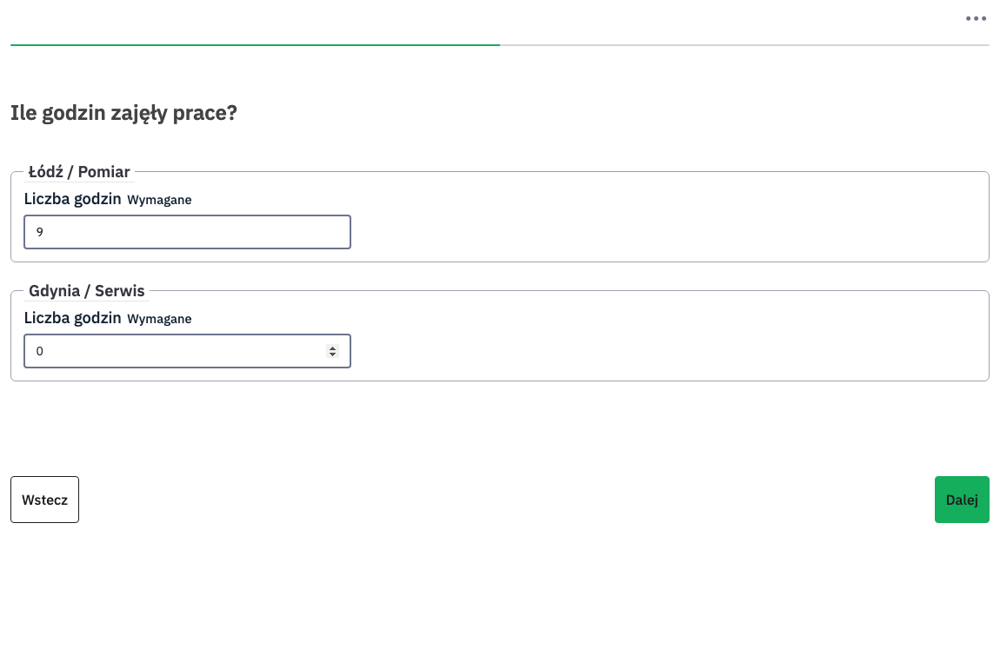

# Dependent JSON questions for LimeSurvey

This plugin and three question themes work on a self-hosted LimeSurvey Community Edition installation. Respondents select locations, specify activities for each city, enter hours in a matrix and explain values above a threshold. Survey authors configure the questions in the admin interface. Each block uses one native response column of question type U. Data stays on the survey server.

[Polski](README.md) · [GitHub releases](https://github.com/lukasz5/limecontrol-plugin-json-questions/releases) · [LimeControl catalogue](https://limecontrol.eu/en/plugins.html)



## Install on your server

Use an administrator account with permission to install extensions. The installation must allow ZIP uploads and meet LimeSurvey's PHP extension requirements. The plugin requires PHP 8.1.29 or later. The LS 7.11.0 installer requires PHP 8.2.27 or later. Integration tests use PHP 8.3. [7.11.0 installer requirements](https://github.com/LimeSurvey/LimeSurvey/blob/e717e9445015c8ac6a03811877e0ac7a9a9b010a/application/models/InstallerConfigForm.php#L53)

| Edition | Plugin | Question themes |
| --- | --- | --- |
| LS 6 | In Configuration, open Plugin manager. Upload the LimeControlJsonQuestions ZIP, confirm installation and activate the plugin. | In Configuration → Themes → Question themes, import each theme ZIP you need. |
| LS 7 | Open Plugins in the installation configuration, upload the plugin ZIP, confirm installation and select Activate. | Open Question themes, import the themes and check their availability on a Huge free text question. |

Download files from the same release, including SHA256SUMS. In the download directory run `sha256sum -c SHA256SUMS` or `shasum -a 256 -c SHA256SUMS`. The plugin ZIP contains the LimeControlJsonQuestions directory. The other archives are LcJsonChoice, LcJsonMatrix and LcJsonFollowup. Install all three themes to run the example.

## Build your first survey

1. Import the [example LSS](examples/fieldwork.lss). Open its survey tools and choose **LimeControl JSON · Editor**. Inspect the source question for each block and the condition on the follow-up.
2. To build it from scratch, add a native choice question called CITY with Łódź and Gdynia as options. Add three subsequent Huge free text questions called WORK, TIME and REASON. Configure each block in the editor and save it.

   | Block | Theme and source | Settings |
   | --- | --- | --- |
   | WORK | Choice for each item, CITY | Add MEASURE and SERVICE as multiple-choice options. |
   | TIME | Table from previous answers, WORK | Add a numeric HOURS column. |
   | REASON | Follow-up, TIME | Add OTHER with a required comment. Show the row when HOURS in its source is greater than 8. |

3. Activate a test copy. Choose both cities, measurement in Łódź and service in Gdynia. Enter **9** and **0** hours respectively. Select Other for Łódź and write a comment. The threshold is only exceeded in Łódź.
4. Choose **Export CSV** and **Codebook CSV** in the survey tools. The [example output](examples/fieldwork-expected.csv) shows stable codes, row paths, zero and a comment. Response IDs and revision identifiers depend on the installation and saved configuration.

Rules combine comparisons using all, any and not. Configure visibility, required values, exclusive options and required comments. The editor offers preceding supported native choice questions and JSON blocks as sources. Keep stable option and column codes when changing translations or updating a definition.

## Large surveys, data and removal

Each block uses one physical response column regardless of the number of visual cells. Other native questions still consume their usual columns. The maximum payload size also limits each block. Split it into smaller blocks if the size limit is reached. Native statistics and the standard response export treat type U as text. The plugin CSV exposes the individual values. The legacy report helps interpret historical answers from the EU-Consult themes. Completing an interactive block requires JavaScript and an active plugin.

Before upgrading, back up the survey, database and installed archives. Resume a test response and check its export after updating. Before removal, export the CSV and codebook, then use **Detach theme and validation** for the configured questions. For a complete uninstall, download a backup of the definitions, detach blocks starting with the last question in the chain and choose **Delete retained configuration** for each detached question. Deactivate the plugin and remove unused themes and the plugin in their respective managers. The native U questions and their saved responses belong to the survey. The plugin creates no tables.

## Compatibility and development

Qualification targets CE 6.15.12, 6.17.19 and 7.11.0 on MySQL/InnoDB and PostgreSQL. Individual qualification jobs identify the exact configuration and install archives fetched from the draft release. [Release qualification runs](https://github.com/lukasz5/limecontrol-plugin-json-questions/actions/workflows/release.yml)

```sh
composer install
npm ci
npx playwright install chromium
php tests/model.php
node tests/respondent.browser.cjs
node tests/respondent.parity.cjs
python3 scripts/package.py --tag v0.1.0
python3 scripts/package.py --verify
python3 scripts/analyse.py /path/to/limesurvey/source
```

Licensed under GPL-2.0-or-later. Question themes extend LimeSurvey's native U question. Historical question themes by Łukasz Szemiako provided the original use cases. [License](LICENSE) · [Security reporting](SECURITY.md)
