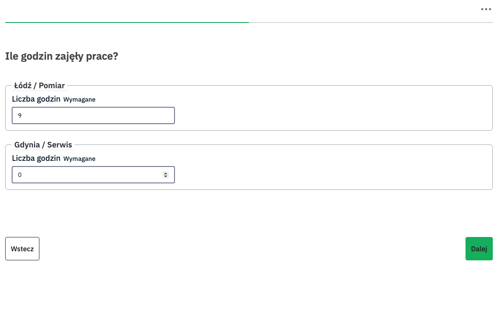

# Pytania zależne JSON dla LimeSurvey

Zestaw dla właścicieli instalacji LimeSurvey Community Edition 6 i 7. Respondent wybiera lokalizacje, w następnym pytaniu określa prace dla każdego miasta, wpisuje godziny do macierzy i uzasadnia wyniki przekraczające próg. Autor konfiguruje ten przebieg w panelu ankiety. Jeden blok zajmuje jedno natywne pole odpowiedzi typu U. Wszystkie dane pozostają na serwerze ankiety.

[English](README.en.md) · [Paczki GitHub Release](https://github.com/lukasz5/limecontrol-plugin-json-questions/releases) · [Katalog LimeControl](https://limecontrol.eu/wtyczki.html)



## Instalacja

Potrzebujesz konta administracyjnego z prawem instalowania rozszerzeń, obsługi wgrywania ZIP w danej instalacji oraz PHP z rozszerzeniami wymaganymi przez LimeSurvey. Kod wtyczki wymaga PHP 8.1.29 lub nowszego. Instalator wydania LS 7.11.0 wymaga co najmniej PHP 8.2.27. Do testów integracyjnych używamy PHP 8.3. [Wymagania instalatora 7.11.0](https://github.com/LimeSurvey/LimeSurvey/blob/e717e9445015c8ac6a03811877e0ac7a9a9b010a/application/models/InstallerConfigForm.php#L53)

| Linia | Wtyczka | Motywy pytań |
| --- | --- | --- |
| LS 6 | W konfiguracji otwórz menedżer wtyczek. Wgraj ZIP `LimeControlJsonQuestions`, potwierdź instalację i aktywuj wtyczkę. | W konfiguracji motywów otwórz **Motywy pytań** i zaimportuj każdy potrzebny ZIP oddzielnie. |
| LS 7 | W konfiguracji instalacji otwórz **Wtyczki**, wgraj ZIP wtyczki, potwierdź i wybierz **Aktywuj**. | Otwórz **Motywy pytań**, zaimportuj ZIP-y i sprawdź ich dostępność przy pytaniu „Bardzo długi tekst”. |

Pobierz wszystkie pliki tej samej wersji oraz `SHA256SUMS`. W katalogu z plikami uruchom `shasum -a 256 -c SHA256SUMS` lub `sha256sum -c SHA256SUMS`. Archiwum wtyczki ma katalog główny `LimeControlJsonQuestions/`. Trzy osobne archiwa zawierają `LcJsonChoice` (wybór), `LcJsonMatrix` (tabela) i `LcJsonFollowup` (pytanie uzupełniające). Do odtworzenia kompletnego przykładu zainstaluj wszystkie trzy.

## Pierwsza ankieta

1. W panelu zaimportuj [ankietę demonstracyjną](examples/fieldwork.lss). Otwórz jej narzędzia i **LimeControl JSON · Edytor**. Sprawdź źródła pytań oraz regułę ustawioną dla pytania uzupełniającego.
2. Aby ułożyć ankietę samodzielnie, dodaj zwykłe pytanie wyboru o kodzie `CITY` z opcjami Łódź i Gdynia. Dodaj później trzy pytania typu U z kodami `WORK`, `TIME` i `REASON`. W edytorze połącz je w kolejności podanej w tabeli. Zapisz każde pytanie. Etykiety można przetłumaczyć przy zachowaniu tych samych kodów.

   | Pytanie | Motyw i źródło | Konfiguracja |
   | --- | --- | --- |
   | WORK | Wybór dla każdej pozycji, źródło CITY | Dodaj opcje wielokrotne MEASURE („Pomiar”) i SERVICE („Serwis”). |
   | TIME | Tabela, źródło WORK | Dodaj kolumnę liczbową HOURS („Godziny”). |
   | REASON | Pytanie uzupełniające, źródło TIME | Dodaj opcję OTHER („Inne”) z komentarzem. Pokaż cały wiersz, gdy HOURS w źródle jest większe od 8. |

3. Aktywuj kopię testową. Wybierz oba miasta, pomiar w Łodzi i serwis w Gdyni. Wpisz kolejno **9** i **0**. Po wybraniu „Inne” wpisz komentarz dotyczący pomiaru. Dla Gdyni pytanie o przekroczenie progu nie ma zastosowania.
4. W narzędziach ankiety wybierz **Eksport CSV** i **Słownik CSV**. [Oczekiwany wynik przykładu](examples/fieldwork-expected.csv) pokazuje trwałe kody, ścieżkę pozycji, liczbę zero i komentarz. Identyfikator odpowiedzi i numer rewizji zależą od instalacji oraz zapisanej konfiguracji.

Edytor pozwala grupować porównania za pomocą „wszystkie”, „dowolny” i zaprzeczenia. Można sterować widocznością, wymaganiem wartości, wyłącznością i wymaganym komentarzem. Źródłem jest wcześniejsze obsługiwane pytanie wyboru lub blok tego zestawu. Wybierz pytanie z listy dostępnej w edytorze. Używaj stałych kodów opcji i kolumn podczas kolejnych tłumaczeń i aktualizacji.

## Duże ankiety, dane i odzyskiwanie

Każdy blok ma jedną fizyczną kolumnę, również gdy wyświetla wiele wierszy i kolumn. Pozostałe natywne pytania nadal zajmują odpowiednie pola LimeSurvey. Rozmiar odpowiedzi w bajtach ogranicza pojemność bloku. Przy komunikacie o przekroczeniu limitu podziel kwestionariusz na mniejsze bloki. Natywna statystyka i standardowy eksport traktują odpowiedź typu U jako tekst. CSV wtyczki rozpisuje poszczególne wartości. Raport historyczny pomaga interpretować odpowiedzi zapisane przez motywy EU-Consult. Walidacja wymaga JavaScriptu w przeglądarce respondenta oraz działającej wtyczki na serwerze.

Przed aktualizacją wykonaj kopię bazy, ankiety i dotychczasowych ZIP-ów. Po aktualizacji wznów odpowiedź testową i sprawdź eksport. Przed usunięciem zestawu zapisz CSV oraz słownik, a następnie skorzystaj z funkcji **Odłącz motyw i walidację** dla pytań objętych konfiguracją. Dla pełnego odinstalowania pobierz kopię definicji, odpinaj bloki od ostatniego pytania w łańcuchu i wybierz **Usuń zachowaną konfigurację** przy każdym odpiętym pytaniu. Wyłącz wtyczkę i usuń nieużywane motywy oraz wtyczkę w ich menedżerach. Podstawowe pytania typu U i zapisane w nich odpowiedzi należą do ankiety. Sama wtyczka nie tworzy tabel.

## Zgodność i rozwój

Macierz kwalifikacji obejmuje CE 6.15.12, 6.17.19 oraz 7.11.0 na MySQL/InnoDB i PostgreSQL. Dokładny wynik dla każdej kombinacji udostępnia zadanie kwalifikacyjne archiwów pobranych z roboczego wydania. [Wyniki uruchomień wydaniowych](https://github.com/lukasz5/limecontrol-plugin-json-questions/actions/workflows/release.yml)

```sh
composer install
npm ci
npx playwright install chromium
php tests/model.php
node tests/respondent.browser.cjs
node tests/respondent.parity.cjs
python3 scripts/package.py --tag v0.1.0
python3 scripts/package.py --verify
python3 scripts/analyse.py /sciezka/do/zrodel/limesurvey
```

Kod wykorzystuje licencję GPL-2.0-or-later. Motywy dziedziczą po podstawowym typie U LimeSurvey. Historyczne motywy Łukasza Szemiako służyły jako wzorzec zachowania. [Licencja](LICENSE) · [Zgłaszanie problemów bezpieczeństwa](SECURITY.md)
